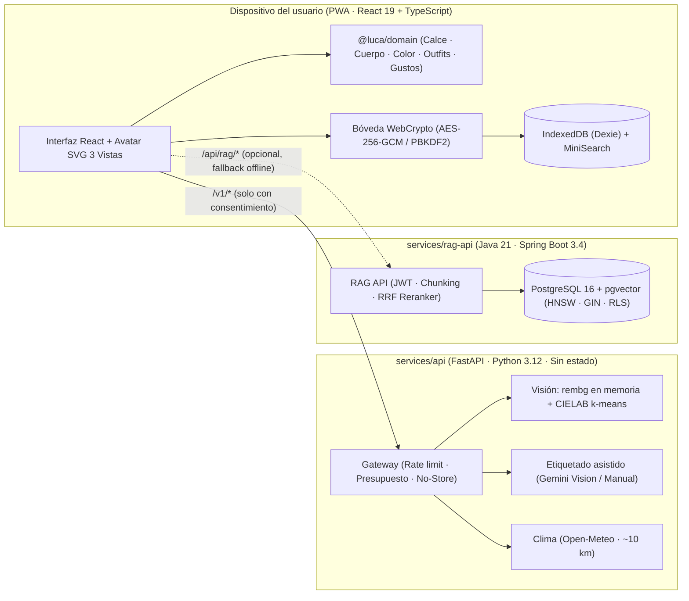

<p align="center">
  
</p>

<p align="center">
  <a href="https://github.com/Cristixn04/Luca/actions/workflows/ci.yml">
    
  </a>
  
  
  
  
  
  
</p>

<p align="center">
  <strong>Luca</strong> calcula cuánta holgura exacta tendrá una prenda en cada zona de tu cuerpo en tres vistas (frente, perfil y espalda), analiza tu colorimetría en 12 estaciones y arma outfits explicables con tu propio clóset — manteniendo tus datos cifrados exclusivamente en tu dispositivo.
</p>

---

## Qué ofrece Luca

| Módulo | Capacidades principales |
| :-- | :-- |
| **Probador paramétrico en 3 vistas** | Modelo corporal único en TypeScript puro (elipses de Ramanujan y bisección) proyectado en **Frente, Perfil y Espalda** para silueta femenina y masculina. Avatar anatómico con cabeza esculpida, sombreado 3D difuminado, 7 categorías de prendas, mapa de calor accesible para daltonismo (`Tenso` · `Ajustado` · `Regular` · `Holgado` · `Oversize`) y sincronización en vivo con los tonos de piel, cabello y ojos del apartado **Color**. |
| **Clóset inteligente y gemelo digital IA** | Gestión local de prendas con tabla de tallas en plano, talla recomendada automática, registro de uso y costo por uso (**CPW**). Al subir una foto real, la API de visión limpia el fondo en memoria, extrae color dominante en CIELAB y sintetiza una especificación visual (`GarmentVisualSpec`) para vestir el avatar coherentemente, conservando la foto original en el giro 3D de la tarjeta. |
| **Colorimetría en 12 estaciones** | Conversión `sRGB -> CIELAB (D65)`, árbol de clasificación con Top-2 estaciones y nivel de confianza, distancia perceptual **CIEDE2000** ($\Delta E_{00}$), paleta curada de 14 tonos por estación y puntaje de armonía sobre tu clóset real. |
| **Outfits explicables con clima y variedad** | Generador por ranuras con puntaje transparente en 6 dimensiones (**Color, Calce, Estilo, Ocasión/clima, Variedad y Gusto**), diversidad garantizada, detección de prendas huérfanas y simulación de cuántos outfits nuevos desbloquea una prenda en lista de deseos. |
| **Memoria explicable y Bóveda Zero-Knowledge** | Aprendizaje local con suavizado de Laplace y decaimiento temporal (vida media de 90 días), controles para fijar, vetar, pausar u olvidar rasgos, y bóveda cifrada con **AES-256-GCM** + **PBKDF2-HMAC-SHA256** ($\ge 600\,000$ iteraciones), clave de recuperación de un solo uso y respaldo cifrado portátil. |
| **Búsqueda local + RAG híbrido opcional** | Búsqueda instantánea en el navegador con `MiniSearch` (p95 $\le 100\text{ ms}$) complementada de forma transparente por un microservicio **Java 21 / Spring Boot 3.4 + PostgreSQL `pgvector`** con índice vectorial **HNSW**, búsqueda léxica **GIN** (`tsvector` en español), fusión **RRF** (*Reciprocal Rank Fusion*) y aislamiento multi-tenant por JWT + **Row-Level Security**. |

---

## Privacidad por diseño

La privacidad en Luca es verificable por arquitectura y pruebas automatizadas E2E:

| Dato | ¿Sale del dispositivo? | Protección aplicada |
| :-- | :-- | :-- |
| Medidas corporales e historial | **Nunca** | Cifrado local AES-256-GCM en IndexedDB |
| Perfil de color (piel, cabello, ojos) | **Nunca** | Cálculo CIELAB/CIEDE2000 100 % en el cliente |
| Gustos, interacciones y registros de uso | **Nunca** | Motor de afinidad local, editable y borrable |
| Fotos del clóset (ingesta asistida) | **Solo con consentimiento explícito** | Reducción de tamaño, borrado de metadatos EXIF, proceso en memoria y `Cache-Control: no-store` |
| Ubicación para clima | **Opcional (redondeada a ~10 km)** | Alternativa manual por ciudad o temperatura |
| Metadatos mínimos para reordenamiento RAG | **Solo texto descriptivo mínimo** | Aislamiento por tenant (JWT + PostgreSQL RLS), sin fotos, medidas ni contraseñas; degradación automática a `MiniSearch` offline |

---

## Arquitectura



---

## Arranque rápido

### Opción 1: Script unificado local (recomendado para desarrollo)

Levanta **PostgreSQL + `pgvector`**, **RAG API (Spring Boot)**, **Vision API (FastAPI)** y la **Web PWA (Vite)** en un solo comando:

```bash
./start-luca.sh
```

Comandos útiles del lanzador:

```bash
./start-luca.sh --status   # Verifica salud de los 4 servicios
./start-luca.sh --rebuild  # Recompila imágenes Docker y reinicia
./start-luca.sh --stop     # Detiene todo el stack limpiamente
```

Puertos locales por defecto:
- **Web PWA**: `http://localhost:5174`
- **API de visión (FastAPI)**: `http://127.0.0.1:8001/v1/health`
- **RAG API (Spring Boot)**: `http://127.0.0.1:8080/v1/health`

### Opción 2: Stack completo con Docker Compose

```bash
docker compose up --build
```

Accede a la aplicación en `http://localhost:8088` (Nginx endurecido con CSP estricta y proxy interno hacia `/v1/*` y `/api/rag/*`).

### Opción 3: Desarrollo manual por módulo

Requisitos: **Node.js 22+**, **pnpm 12+**, **Python 3.12+** y **Java 21 + Maven 3.9+** (opcional para `rag-api`).

```bash
# 1. Instalar dependencias del monorepo
pnpm install

# 2. Frontend + dominio en caliente
pnpm dev

# 3. API de visión (FastAPI)
cd services/api
python3 -m venv .venv && source .venv/bin/activate
pip install -e ".[dev]"
uvicorn app.main:app --reload --port 8001

# 4. Microservicio RAG (Spring Boot)
cd services/rag-api
mvn spring-boot:run
```

> **Variables de entorno opcionales (`services/api/.env`):** si deseas activar el etiquetado asistido por visión con Gemini, define `GEMINI_API_KEY`. Sin clave, Luca opera de forma 100 % funcional en modo local/manual.

---

## Estructura del repositorio

```text
.
├── apps/web/                 # PWA React 19 + Vite + Tailwind + Avatar SVG 3 vistas + Bóveda WebCrypto
├── packages/domain/          # Dominio puro en TypeScript (cero dependencias de red o DOM)
├── services/api/             # API sin estado en FastAPI (rembg, CIELAB k-means, tagging, clima)
├── services/rag-api/         # Microservicio Java 21 + Spring Boot 3.4 + PostgreSQL/pgvector (HNSW + GIN + RRF)
├── config/                   # Configuración calibrable (bandas de calce, paletas)
├── docs/                     # Especificación completa, ADRs, privacidad, despliegue y assets
├── .github/                  # CI (3 jobs), Dependabot agrupado, CODEOWNERS y ruleset de rama principal
├── docker-compose.yml        # Orquestación producción (web + api + rag-api + postgres/pgvector)
└── start-luca.sh             # Lanzador unificado de desarrollo
```

---

## Calidad, pruebas y CI

El pipeline de GitHub Actions ([`.github/workflows/ci.yml`](.github/workflows/ci.yml)) valida de forma automática las tres capas del monorepo en cada push y pull request hacia `main`:

```bash
# Dominio y Web (lint, tipos, pruebas con cobertura, build PWA y E2E Playwright)
pnpm lint
pnpm typecheck
pnpm test:coverage
pnpm build
pnpm e2e

# API de visión (Python 3.12)
cd services/api && ruff check . && mypy app tests && pytest -v

# Servicio RAG (Java 21 / Spring Boot)
cd services/rag-api && mvn -B test
```

---

## Documentación técnica

- [Especificación completa de arquitectura, motores y requisitos](docs/architecture-spec.md)
- [Motor de calce y bandas configurables](docs/fit-engine.md)
- [Colorimetría estacional CIELAB / CIEDE2000](docs/colorimetry.md)
- [Contrato de la API sin estado](docs/api.md)
- [Política de privacidad](docs/privacy-policy.md) y [Política de seguridad](SECURITY.md)
- [Guía de despliegue](docs/deployment.md) y [Decisiones de arquitectura (ADR)](docs/adr/)
- [Registro de cambios (`CHANGELOG.md`)](CHANGELOG.md) y [Guía de contribución](CONTRIBUTING.md)

---

## Autor y Licencia

Desarrollado por **Cristian Camilo Muñoz Rodríguez** ([@Cristixn04](https://github.com/Cristixn04)).

Distribuido bajo licencia **MIT**. Consulta el archivo [LICENSE](LICENSE) para más detalles.
