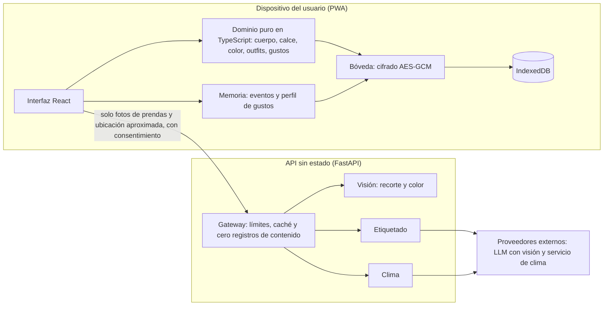
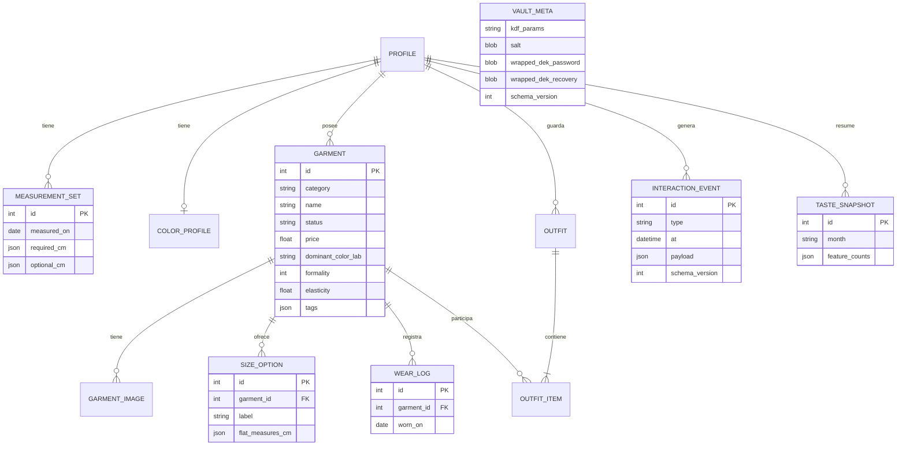

# Luca

**Clóset inteligente, probador de calce en tres vistas y asesor de color. Una web instalable que recuerda tus gustos y guarda tus datos solo en tu dispositivo.**

-blue)


Luca te dice **cuánta holgura tendrá una prenda en cada zona de tu cuerpo** (vista de frente, de perfil y de espalda), **qué colores te favorecen** y **qué outfits puedes armar con la ropa que ya tienes**. Recuerda lo que haces con la app y aprende tus gustos para recomendarte mejor.

La promesa de privacidad es de diseño, no de buena voluntad: **tus medidas, tu perfil de color, tus gustos y tu historial nunca salen de tu dispositivo**, y se guardan cifrados con una contraseña que solo tú conoces. Los servicios en la nube son una API **sin estado y sin cuentas** que solo procesa lo mínimo, con tu permiso, y no guarda nada.

> **Estado del documento:** hitos M0 a M8 completados (**`v0.7` — Colorimetría estacional de 12 estaciones, sRGB↔CIELAB D65, CIEDE2000, paletas curadas y afinidad explicable de prendas**); siguiente hito activo: **M9 (`v0.8`)**. Las secciones de instalación y uso describen el resultado objetivo y se activan a medida que avanzan los hitos.

---

## Panel de estado

Este panel es la fuente de verdad de "dónde estoy". Se actualiza al cerrar cada hito.

**Progreso global: 204 / 280 h** (núcleo M0–M11) · Hito actual: **M9**

| Hito | Nombre | Release | Horas est. | Estado |
| :-- | :-- | :-- | --: | :-- |
| M0 | Fundaciones (monorepo, CI, diseño base) | v0.0 | 13 | Completado |
| M1 | Dominio en TypeScript: cuerpo y calce | — | 24 | Completado |
| M2 | Avatar de frente y probador con mapa de calor | **v0.1** | 26 | Completado |
| M3 | Almacenamiento local seguro y bóveda cifrada | **v0.2** | 26 | Completado |
| M4 | Clóset local y tallas | **v0.3** | 22 | Completado |
| M5 | Vistas de perfil y de espalda | v0.4 | 22 | Completado |
| M6 | API de servicios e ingesta de fotos | v0.5 | 29 | Completado |
| M7 | Etiquetado y búsqueda | v0.6 | 16 | Completado |
| M8 | Colorimetría estacional | v0.7 | 26 | Completado |
| M9 | Outfits, clima, uso y costo por uso | v0.8 | 28 | Pendiente |
| M10 | Memoria y gustos | v0.9 | 22 | Pendiente |
| M11 | Pulido, accesibilidad y lanzamiento | **v1.0** | 26 | Pendiente |
| M12 | Opcional: asistente, calibración, sincronización (estudio) | v1.1 | 20 | Pendiente |

> **Camino mínimo útil:** M0 a M4 suman **111 h** y ya entregan un producto privado y completo: medidas cifradas, probador con mapa de calor y clóset con talla recomendada. Todo lo demás se suma encima sin rehacer nada.

Cada release deja un producto **usable por sí mismo**. Si el tiempo se acaba en cualquier hito, lo construido hasta ahí funciona.

---

## Contenido

1. [Qué es y qué no es](#1-qué-es-y-qué-no-es)
2. [Principios de diseño](#2-principios-de-diseño)
3. [Alcance](#3-alcance)
4. [Memoria y privacidad](#4-memoria-y-privacidad)
5. [Experiencia visual](#5-experiencia-visual)
6. [Requisitos funcionales](#6-requisitos-funcionales)
7. [Requisitos no funcionales](#7-requisitos-no-funcionales)
8. [Arquitectura](#8-arquitectura)
9. [Modelo de datos](#9-modelo-de-datos)
10. [Motores de decisión](#10-motores-de-decisión)
11. [Stack tecnológico](#11-stack-tecnológico)
12. [Estructura del repositorio](#12-estructura-del-repositorio)
13. [Instalación y uso](#13-instalación-y-uso)
14. [Calidad y pruebas](#14-calidad-y-pruebas)
15. [Seguridad](#15-seguridad)
16. [Plan de trabajo por hitos](#16-plan-de-trabajo-por-hitos)
17. [Proceso de trabajo individual](#17-proceso-de-trabajo-individual)
18. [Riesgos y mitigaciones](#18-riesgos-y-mitigaciones)
19. [Decisiones de arquitectura (ADR)](#19-decisiones-de-arquitectura-adr)
20. [Glosario](#20-glosario)
21. [Licencia](#21-licencia)

---

## 1. Qué es y qué no es

### Qué resuelve

| Pregunta del usuario | Respuesta de Luca |
| :-- | :-- |
| "¿Esta prenda me va a quedar bien?" | Holgura en centímetros por zona, con mapa de calor en tres vistas y talla recomendada |
| "¿Qué colores me favorecen?" | Perfil de color en 12 estaciones con nivel de confianza y paleta sugerida |
| "Tengo ropa pero no sé qué combinar" | Outfits sugeridos según ocasión, clima y tus gustos, con el desglose de por qué |
| "¿Vale la pena comprar esto?" | Talla recomendada, cuántos outfits nuevos desbloquea y costo por uso proyectado |
| "¿Por qué me recomienda esto?" | Un panel donde ves, corriges y borras lo que la app ha aprendido de ti |

### Qué no es

- **No es un probador fotorrealista.** Existen modelos generativos de prueba virtual que producen imágenes realistas; Luca no compite en eso. Ofrece información cuantitativa, reproducible y privada (cuántos centímetros de holgura hay en cada zona), que una imagen generada no da.
- **No genera imágenes ni usa modelos de difusión.**
- **No es una tienda ni extrae datos de tiendas.**
- **No hace juicios sobre el cuerpo.** El lenguaje describe la prenda ("la prenda queda ajustada en la cintura"), nunca a la persona.
- **No es una red social ni una cuenta en la nube.** No existen usuarios en un servidor.

---

## 2. Principios de diseño

1. **Tus datos viven en tu dispositivo.** El servidor no tiene base de datos de usuarios, ni cuentas, ni registros de contenido.
2. **Privacidad por diseño verificable.** Cada promesa de privacidad tiene una prueba automática que la comprueba.
3. **Cifrado por defecto.** La bóveda cifrada se ofrece en el primer arranque y se recomienda activarla.
4. **Determinista y explicable.** Toda cifra sale de una fórmula documentada y muestra su desglose. Lo aprendido de ti también.
5. **Tú mandas sobre la memoria.** Todo lo que se recuerda se puede ver, editar, pausar, exportar y borrar.
6. **Todo lo automático es editable.** Color detectado, etiquetas, recorte: siempre puedes corregirlos.
7. **Degradación elegante.** Sin conexión o sin permiso para usar la API, todo lo manual sigue funcionando.
8. **Dominio puro y testeable.** La lógica de calce, color, outfits y gustos no depende del navegador, de la red ni de frameworks.
9. **Cada hito es un release usable.**
10. **Honestidad sobre los límites.** Las estimaciones se presentan como estimaciones, y las limitaciones del enfoque se documentan.

---

## 3. Alcance

### Dentro de v1.0

- Medidas corporales y un modelo de cuerpo único con **tres vistas 2D (frente, perfil y espalda)** generadas con SVG.
- Probador de calce con mapa de calor para camiseta, manga larga, chaqueta, pantalón, short, falda y vestido.
- Clóset personal con fotos, tallas, medidas, precio y registro de uso.
- Recorte de fondo y color dominante de las fotos, y etiquetado asistido, con corrección manual.
- Búsqueda en texto libre dentro del dispositivo.
- Colorimetría de 12 estaciones y puntaje de armonía.
- Generador de outfits con clima, desglose, costo por uso, prendas huérfanas y lista de deseos.
- **Memoria persistente y aprendizaje de gustos**, con un panel de control.
- **Bóveda cifrada**, clave de recuperación, respaldo cifrado y borrado total.
- Web instalable (PWA) con funcionamiento sin conexión para todo lo local. Español e inglés, cm y pulgadas.

### Fuera de alcance (decisión consciente)

| Fuera de alcance | Motivo | Alternativa en v1.0 |
| :-- | :-- | :-- |
| Deformar fotos de prendas sobre el avatar | Es un problema de investigación y se vería artificial | Plantillas SVG paramétricas + tarjeta con la foto real |
| Detección automática de keypoints o medidas desde fotos | Requiere modelos entrenados y una referencia de escala | El usuario ingresa medidas o elige una talla de una tabla |
| Estimar el cuerpo desde fotos | Poco fiable y muy sensible en privacidad | Medidas manuales con guía ilustrada |
| Detectar el tono de piel desde una foto sin calibración | La luz y la cámara dominan el resultado | Selección guiada con escalas de muestras |
| **Cuentas y sincronización entre dispositivos** | Añade servidores con datos personales y una superficie de ataque grande | Respaldo cifrado manual; la sincronización cifrada de extremo a extremo se estudia en M12 |
| Avatar 3D o poses | Costo desproporcionado | Tres vistas 2D coherentes |
| Scraping de tiendas o precios en vivo | Frágil y legalmente ambiguo | Precio ingresado a mano |
| App nativa de tienda | Costo alto de mantenimiento | PWA; si hiciera falta, se envuelve la misma web con Capacitor |
| Analítica y telemetría | Contradice el principio de privacidad | Ninguna |

### A quién sirve

- **Quien compra online** y quiere saber qué talla pedir antes de comprar.
- **Quien tiene mucha ropa** y no sabe qué combinar.
- **Quien quiere entender sus colores** sin pagar una asesoría.
- **Quien quiere una herramienta de moda que no venda ni comparta sus datos.**

---

## 4. Memoria y privacidad

Luca recuerda lo que haces para personalizar tus recomendaciones. Esa memoria es **tuya**: se guarda en tu dispositivo, cifrada, y tú decides qué se queda.

### 4.1. Qué recuerda

| Memoria | Qué guarda | Para qué sirve |
| :-- | :-- | :-- |
| Perfil corporal | Medidas con historial por fecha | Calce y avatar |
| Perfil de color | Muestras de piel, cabello y ojos, y la estación resultante | Colorimetría |
| Clóset | Prendas, tallas, fotos, etiquetas, precio y estado | Todo el sistema |
| Uso | Registro de cada vez que usaste una prenda | Costo por uso y variedad |
| Outfits | Vistos, guardados y favoritos | Recomendaciones |
| Interacciones | Me gusta, no me gusta, descartes, correcciones de etiquetas y cambios de preferencias | Aprender tus gustos |
| Preferencias | Calce preferido, rango de formalidad, colores fijados o vetados, idioma y unidades | Personalización |

> **Las búsquedas no se registran por defecto.** Puedes activarlo si quieres que influyan en las sugerencias. Es una decisión de minimización de datos.

### 4.2. Qué sale del dispositivo y qué no

| Dato | ¿Sale del dispositivo? |
| :-- | :-- |
| Medidas corporales | **Nunca.** El cálculo de calce corre en tu navegador |
| Perfil de color | **Nunca** |
| Gustos, interacciones e historial | **Nunca** |
| Clóset (metadatos, precios, usos) | **Nunca** |
| Foto de una prenda | **Solo con tu consentimiento:** se reduce de tamaño y se le borran los metadatos EXIF antes de enviarse. La API la procesa en memoria y la descarta |
| Ubicación para el clima | **Solo coordenadas redondeadas (≈ 10 km), y es opcional.** Alternativas: elegir una ciudad o ingresar la temperatura |
| Consultas al asistente (opcional, M12) | Solo el texto de la consulta, sin datos personales |

Puedes **desactivar por completo el uso de la API** y trabajar solo con datos manuales (recorte manual y etiquetas manuales).

### 4.3. Cómo aprende (sin caja negra)

Los gustos se calculan **en tu dispositivo** con afinidades simples y explicables por rasgo (color, categoría, formalidad, patrón, calce), con decaimiento en el tiempo para que los gustos viejos pesen menos. La fórmula está en [10.6](#106-motor-de-gustos). No hay un modelo opaco: puedes ver cada afinidad, cuántos eventos la sustentan y borrarla.

### 4.4. Tus controles

Ver todo lo aprendido, editar o fijar preferencias, pausar el aprendizaje, olvidar por categoría, elegir la retención de datos, exportar un respaldo cifrado, bloquear la app y borrar todo.

---

## 5. Experiencia visual

El objetivo es una interfaz sobria, precisa y agradable: paneles ordenados, tipografía legible y cero decoración superflua. Sin emojis en la interfaz; solo iconografía SVG (Lucide).

### 5.1. Sistema de diseño

| Token | Claro | Oscuro |
| :-- | :-- | :-- |
| `--bg` | `#FAF9F7` | `#111315` |
| `--surface` | `#FFFFFF` | `#1A1D20` |
| `--ink` | `#1B1F23` | `#ECEEF0` |
| `--muted` | `#5B6670` | `#9AA4AD` |
| `--accent` | `#1F5F6B` | `#5FB3C0` |
| `--border` | `#E4E0DA` | `#2A2F34` |

Los valores se verifican con un comprobador de contraste en la tarea T0.4 (objetivo WCAG 2.2 AA, 4.5:1 en texto).

- **Tipografía:** Manrope para títulos, Inter para texto. Las medidas usan `font-variant-numeric: tabular-nums`.
- **Escala:** 12 / 14 / 16 / 20 / 24 / 32 px. Espaciado base de 4 px. Radios de 8 y 12 px.
- **Movimiento:** transiciones de 150 a 250 ms, y se respeta `prefers-reduced-motion`.
- **Componentes:** shadcn/ui (Radix) para accesibilidad ya resuelta.

### 5.2. Paleta del mapa de calor

Diseñada para daltonismo (naranja a turquesa a azul, no rojo a verde). Además del color, **cada estado lleva etiqueta numérica y patrón**.

| Estado | Color | Hex | Patrón |
| :-- | :-- | :-- | :-- |
| Tenso | Naranja rojizo | `#C2410C` | Rayado diagonal |
| Ajustado | Ámbar | `#E0A526` | Puntos |
| Regular | Turquesa | `#2A9D8F` | Liso |
| Holgado | Azul | `#5B8DEF` | Puntos finos |
| Oversize | Violeta | `#7C6FD6` | Cuadrícula |

### 5.3. Las tres vistas del avatar

Un único `BodyModel` independiente de la vista produce tres proyecciones coherentes. La misma zona muestra **siempre el mismo estado** en las tres vistas (hay una prueba automática para ello).

| Vista | Qué muestra | Medidas que usa | Medidas opcionales que la mejoran |
| :-- | :-- | :-- | :-- |
| **Frente** | Hombros, pecho, cintura, cadera y largo | Las obligatorias | Largo de torso |
| **Perfil** | Fondo (profundidad) de pecho, cintura y cadera; cómo cae la prenda | Las obligatorias; el fondo se estima | Fondo medido de pecho, cintura y cadera |
| **Espalda** | Hombros, espalda, cintura y cadera | Las obligatorias | Ancho y largo de espalda |

- Cuando una vista usa un valor estimado en lugar de uno medido, la interfaz lo marca como **"estimado"**.
- La prenda se dibuja sobre la silueta del cuerpo: la **holgura se ve** como el espacio entre ambos contornos (a escala, con un límite visual máximo para no deformar el dibujo).
- Cada categoría de prenda necesita una plantilla SVG por vista.
- En pantallas anchas hay un modo de **3 vistas a la vez**; en móvil se desliza entre ellas.

### 5.4. Pantallas principales (esquemas)

**Probador**

```
┌─────────────────────────────────────────────────────────────────────┐
│ Luca         Probador   Clóset   Outfits   Color   Memoria   [ES]   │
├────────────────┬──────────────────────────────┬─────────────────────┤
│ MEDIDAS        │ [Frente|Perfil|Espalda|3 v.] │ PRENDA              │
│ Pecho   92 cm  │                              │ Camiseta de lino    │
│ Cintura 78 cm  │        [ Avatar SVG ]        │ Talla  [ M  v ]     │
│ Cadera  98 cm  │        con mapa de calor     │                     │
│ Hombros 44 cm  │                              │ Pecho    +12.0 cm   │
│ + opcionales   │   [x] Mapa de calor          │ Hombros   +1.5 cm   │
│ [Guía de       │   Fondo: estimado            │ Veredicto: Holgado  │
│  medición]     │                              │ Talla sugerida: S   │
└────────────────┴──────────────────────────────┴─────────────────────┘
```

**Clóset**

```
┌─────────────────────────────────────────────────────────────────────┐
│ Buscar: [ camisa de lino para verano        ]   [+ Añadir prenda]   │
│ Filtros: Categoría v   Color v   Estado v   Formalidad v            │
├─────────────────────────────────────────────────────────────────────┤
│ ┌────────┐ ┌────────┐ ┌────────┐ ┌────────┐ ┌────────┐             │
│ │ foto   │ │ foto   │ │ foto   │ │ foto   │ │ foto   │             │
│ │ Camisa │ │ Jean   │ │ Buzo   │ │ Tenis  │ │ Falda  │             │
│ │ CPW $4 │ │ CPW $2 │ │ Sin uso│ │ CPW $9 │ │ Huérf. │             │
│ └────────┘ └────────┘ └────────┘ └────────┘ └────────┘             │
└─────────────────────────────────────────────────────────────────────┘
```

**Tablero de outfit**

```
┌──────────────────────────────┬──────────────────────────────────────┐
│ Propuesta 1 de 3   Score 84  │ Desglose                             │
│                              │ Color     █████████░  22 / 25        │
│     [ Avatar con prendas ]   │ Estilo    ████████░░  12 / 15        │
│     [ en capas (z-index) ]   │ Calce     █████████░  17 / 20        │
│                              │ Ocasión   ██████████  15 / 15        │
│ [foto][foto][foto][foto]     │ Variedad  ███████░░░   7 / 10        │
│ [Guardar]  [Lo usé hoy]      │ Gusto     ███████░░░  11 / 15        │
│ [Me gusta] [No me gusta]     │ [Otra propuesta]                     │
└──────────────────────────────┴──────────────────────────────────────┘
```

**Memoria**

```
┌─────────────────────────────────────────────────────────────────────┐
│ Memoria                                  Aprendizaje: [ Activo  v ] │
├──────────────────────────────┬──────────────────────────────────────┤
│ LO QUE HE APRENDIDO          │ DETALLE: Color · Tonos tierra        │
│ Colores   Tierra  ████████░  │ Afinidad 0,78 (14 eventos)           │
│           Neón    ██░░░░░░░  │ Último evento: hace 3 días           │
│ Formalidad  3 a 4  ███████░  │ [Fijar como favorito] [Olvidar]      │
│ Calce     Regular ██████░░░  │                                      │
│ Categoría Camisas ███████░░  │ Retención: 12 meses  [ Cambiar ]     │
├──────────────────────────────┴──────────────────────────────────────┤
│ [Exportar respaldo cifrado]   [Olvidar todo lo aprendido]           │
└─────────────────────────────────────────────────────────────────────┘
```

**Desbloqueo de la bóveda**

```
┌──────────────────────────────────────┐
│                 Luca                 │
│       Tus datos están cifrados       │
│                                      │
│   Contraseña  [ ****************  ]  │
│   [ Desbloquear ]                    │
│                                      │
│   ¿Olvidaste la contraseña?          │
│   Usar la clave de recuperación      │
└──────────────────────────────────────┘
```

### 5.5. Accesibilidad

Navegación completa por teclado, etiquetas y roles ARIA, contraste AA, foco visible, textos alternativos y diseño responsive desde 360 px de ancho.

---

## 6. Requisitos funcionales

Prioridad según MoSCoW: **M**ust (imprescindible), **S**hould (importante), **C**ould (deseable).

### 6.1. Perfil, cuerpo y avatar

| ID | Requisito | Prior. | Hito |
| :-- | :-- | :-: | :-: |
| RF-01 | Capturar altura, ancho de hombros, pecho, cintura, cadera y entrepierna con validación de rango y unidades cm/in | M | M1-M2 |
| RF-02 | Aceptar medidas opcionales: largo de torso, fondo de pecho, cintura y cadera, y ancho y largo de espalda | S | M5 |
| RF-03 | Generar un avatar SVG de frente a partir del modelo de cuerpo y redibujarlo al cambiar un valor | M | M2 |
| RF-04 | Generar avatares de perfil y de espalda coherentes con el de frente, marcando como "estimado" lo que falte por medir | M | M5 |
| RF-05 | Mostrar una guía ilustrada de cómo medirse correctamente | S | M2, M5 |
| RF-06 | Guardar historial de medidas con fecha | C | M11 |

### 6.2. Catálogo de prendas

| ID | Requisito | Prior. | Hito |
| :-- | :-- | :-: | :-: |
| RF-07 | CRUD de prendas: categoría, nombre, marca, precio, fecha, etiquetas y estado (propia o lista de deseos) | M | M4 |
| RF-08 | Registrar medidas por talla de cada prenda (tabla de tallas) | M | M4 |
| RF-09 | Subir fotos desde archivo, arrastrar y soltar o cámara del móvil, con recorte automático de fondo y alternativa manual | M | M6 |
| RF-10 | Calcular el color dominante de la prenda y permitir corregirlo | M | M6 |
| RF-11 | Sugerir etiquetas (categoría, patrón, estilo, formalidad, temporada) con confianza, todas editables | S | M7 |
| RF-12 | Buscar en texto libre dentro del dispositivo y mostrar prendas similares | S | M7 |

### 6.3. Calce

| ID | Requisito | Prior. | Hito |
| :-- | :-- | :-: | :-: |
| RF-13 | Calcular la holgura en cm por zona y su estado (Tenso, Ajustado, Regular, Holgado, Oversize) | M | M1 |
| RF-14 | Renderizar un mapa de calor por vista con leyenda y etiquetas numéricas | M | M2, M5 |
| RF-15 | Permitir elegir la preferencia de calce (ajustado, regular, holgado) | S | M2 |
| RF-16 | Recomendar la mejor talla entre las disponibles de una prenda | M | M4 |

### 6.4. Color

| ID | Requisito | Prior. | Hito |
| :-- | :-- | :-: | :-: |
| RF-17 | Definir el perfil de color (piel, cabello, ojos) mediante escalas guiadas de muestras | M | M8 |
| RF-18 | Clasificar en 12 estaciones, mostrar las 2 más probables y un nivel de confianza | M | M8 |
| RF-19 | Calcular el puntaje de armonía de una prenda y de un outfit, con desglose | M | M8, M9 |
| RF-20 | Mostrar la paleta de la estación y permitir ignorar la recomendación | S | M8 |

### 6.5. Outfits y clóset

| ID | Requisito | Prior. | Hito |
| :-- | :-- | :-: | :-: |
| RF-21 | Generar al menos 3 outfits diversos filtrando por ocasión, clima y formalidad | M | M9 |
| RF-22 | Mostrar el tablero del outfit: avatar en capas en las tres vistas y tarjetas con las fotos reales | M | M9 |
| RF-23 | Registrar usos y calcular el costo por uso (CPW) | M | M9 |
| RF-24 | Detectar prendas huérfanas y brechas del clóset; para la lista de deseos, mostrar cuántos outfits nuevos desbloquea | S | M9 |
| RF-25 | Guardar outfits favoritos | S | M9 |
| RF-26 | Obtener el clima por API con ubicación aproximada, con alternativa manual | S | M9 |

### 6.6. Memoria y gustos

| ID | Requisito | Prior. | Hito |
| :-- | :-- | :-: | :-: |
| RF-27 | Recordar de forma persistente medidas, clóset, perfil de color, preferencias e historial de interacciones | M | M3-M10 |
| RF-28 | Aprender gustos desde el feedback y los usos de forma explicable, con arranque neutro mientras haya pocos datos | M | M10 |
| RF-29 | Ofrecer un panel "Memoria" para ver, editar, pausar el aprendizaje, olvidar por categoría y borrar todo | M | M10 |
| RF-30 | Permitir configurar la retención de eventos antiguos | S | M10 |

### 6.7. Seguridad y control de datos

| ID | Requisito | Prior. | Hito |
| :-- | :-- | :-: | :-: |
| RF-31 | Bóveda cifrada con contraseña y bloqueo automático por inactividad | M | M3 |
| RF-32 | Clave de recuperación generada y mostrada una sola vez | M | M3 |
| RF-33 | Exportar e importar un respaldo cifrado y borrar todos los datos | M | M3 |
| RF-34 | Pedir consentimiento explícito antes de enviar fotos a la API y permitir operar sin ella | M | M6 |
| RF-35 | Solicitar almacenamiento persistente y recordar hacer respaldos | M | M3 |

### 6.8. Plataforma

| ID | Requisito | Prior. | Hito |
| :-- | :-- | :-: | :-: |
| RF-36 | Web instalable (PWA) con funcionamiento sin conexión para todo lo local | M | M2, M11 |
| RF-37 | Interfaz en español e inglés | S | M11 |
| RF-38 | Asistente en lenguaje natural opcional que traduce consultas a filtros estructurados | C | M12 |

---

## 7. Requisitos no funcionales

Cada requisito indica **cómo se verifica**. Si no se puede verificar, no es un requisito.

| ID | Requisito | Objetivo | Verificación |
| :-- | :-- | :-- | :-- |
| RNF-01 | Latencia de búsqueda local | p95 ≤ 100 ms con 1.000 prendas | Benchmark con Vitest en CI |
| RNF-02 | Análisis de una foto (API) | p95 ≤ 10 s de extremo a extremo, con progreso y cancelación; tiempo máximo de 20 s | Medición con las 30 fotos de prueba |
| RNF-03 | Respuesta del avatar al mover un control | ≤ 50 ms | Perfil de rendimiento del navegador |
| RNF-04 | Determinismo | La misma entrada produce el mismo SVG y los mismos puntajes | Pruebas con hash del SVG y casos *golden* |
| RNF-05 | Exactitud geométrica del avatar | El ancho dibujado coincide con la fórmula en ≤ 0,5 % | Pruebas unitarias del dominio |
| RNF-06 | Privacidad por diseño | Medidas, perfil de color, gustos e historial nunca se envían a la API; la API no persiste ni registra contenido; cero analítica | Prueba e2e que intercepta toda la red y comprueba que ninguna petición contiene esos datos |
| RNF-07 | Cifrado | AES-GCM de 256 bits, clave derivada con PBKDF2-HMAC-SHA256 con ≥ 600.000 iteraciones, nonce aleatorio de 96 bits por registro | Pruebas con vectores conocidos y revisión de diseño |
| RNF-08 | Integridad y migraciones | Esquema versionado con respaldo previo; ninguna migración pierde datos; AES-GCM detecta manipulación | Pruebas de migración y de manipulación |
| RNF-09 | Robustez de la API | Límite de tamaño, verificación del tipo real del archivo, tiempos máximos, límite de uso y tope de gasto diario | Pruebas de contrato (OpenAPI) y de carga ligera |
| RNF-10 | Accesibilidad | WCAG 2.2 AA | `axe` y Lighthouse en CI |
| RNF-11 | Compatibilidad | Navegadores actuales (Chrome, Edge, Firefox, Safari) en escritorio y móvil desde 360 px; instalable | Prueba manual por plataforma |
| RNF-12 | Mantenibilidad | Cobertura del dominio ≥ 90 %, TypeScript `strict`, CI en verde para fusionar | Reglas de CI |
| RNF-13 | Degradación elegante | Con la red bloqueada o sin consentimiento, todas las funciones locales operan | Prueba e2e con red bloqueada |
| RNF-14 | Carga inicial | LCP ≤ 2,5 s en Lighthouse móvil; app shell en caché | Lighthouse en CI |

> **Nota sobre precisión.** Los resultados de calce dependen de la calidad de las medidas ingresadas (una cinta métrica manual puede errar 1 a 2 cm). Luca no promete exactitud sobre el cuerpo real, sino cálculos correctos y consistentes sobre los datos que recibe.

---

## 8. Arquitectura

Una **web instalable (PWA)** cuyo **dominio corre en el dispositivo**, más una **API sin estado** que solo ofrece servicios que no pueden o no deben hacerse en el navegador (visión por computadora, IA e integraciones). Ambas partes usan arquitectura hexagonal (puertos y adaptadores).



**Reparto de responsabilidades**

| Dónde | Qué hace | Por qué ahí |
| :-- | :-- | :-- |
| Dispositivo | Medidas, avatar, calce, color, outfits, gustos, almacenamiento, cifrado, búsqueda | Privacidad, respuesta instantánea y funcionamiento sin conexión |
| API | Recorte de fondo, color dominante, etiquetado con LLM, clima, (opcional) asistente | Modelos pesados, claves de proveedores y límites de uso |

**Puertos del dispositivo:** `LocalStore`, `Vault`, `ApiClient` (generado desde OpenAPI), `Clock`.

**Puertos de la API:** `BackgroundRemover`, `Tagger`, `WeatherProvider`, `LanguageModel`. Cada uno tiene un adaptador real y uno simulado para pruebas.

**Reglas de dependencia:**
- `packages/domain` no importa nada del navegador, de React ni de la red.
- La API no calcula calce, color ni outfits: esa lógica vive solo en el dominio del cliente.
- Las claves de proveedores existen **solo** en el servidor, nunca en el frontend.

### API (resumen)

La API es **sin estado**: no tiene base de datos, no hay sesiones y no persiste nada.

| Método y ruta | Descripción |
| :-- | :-- |
| `POST /v1/vision/analyze` | Recibe una foto reducida y devuelve recorte, color dominante y, opcionalmente, etiquetas |
| `GET /v1/weather` | Clima por coordenadas redondeadas |
| `POST /v1/assistant/parse` | (Opcional, M12) Convierte una consulta a filtros |
| `GET /v1/health` | Estado del servicio |
| `GET /v1/openapi.json` | Contrato; de él se genera el cliente TypeScript |

**Controles de la API:** token anónimo de instalación (un identificador aleatorio generado en el dispositivo, sin vínculo con una persona), límite de peticiones, tope de gasto diario con corte automático, caché del clima, tiempos máximos, reintentos con espera creciente hacia los proveedores y `Cache-Control: no-store` en las respuestas con contenido del usuario.

---

## 9. Modelo de datos

Los datos viven en **IndexedDB del dispositivo**, no en un servidor.



- Las medidas de prenda se guardan **en plano** (ancho de axila a axila, etc.), como las publican las tablas de tallas. El perímetro se calcula multiplicando por 2.
- `PROFILE` existe desde el inicio para permitir varios perfiles locales más adelante sin migrar.
- **Con la bóveda activa**, cada registro se guarda como un sobre cifrado `{id, store, iv, ciphertext}`; solo `id` y `store` quedan en claro. Las consultas se hacen en memoria tras desbloquear (un clóset personal tiene cientos de prendas, no millones). Las fotos se cifran como blobs y se descifran bajo demanda.
- Esquema versionado con Dexie. Cada migración es una prueba automática y hace un respaldo previo.
- `INTERACTION_EVENT` es un **registro de solo añadir**; los eventos antiguos se compactan en `TASTE_SNAPSHOT` según la política de retención.

---

## 10. Motores de decisión

Todos los motores viven en `packages/domain` (TypeScript puro), son funciones puras y tienen pruebas con casos *golden* compartidos en JSON.

### 10.1. Motor de calce (Fit)

**Entradas:** perímetros corporales (cm), medidas planas de la prenda (cm), elasticidad de la tela y categoría.

```
circ_prenda      = ancho_plano × 2
holgura          = circ_prenda − circ_cuerpo
alivio_elastico  = circ_prenda × elasticidad     # 0 % tela plana · 5–8 % punto · 10–20 % con elastano

si holgura + alivio_elastico < 0    →  TENSO
si holgura < 0 (el alivio compensa) →  AJUSTADO (por elasticidad)
en otro caso                        →  banda según la tabla
```

**Bandas por defecto** (cm, intervalos semiabiertos `[a, b)`, **sin huecos**; se configuran en `config/fit_bands.json`):

| Zona | Ajustado | Regular | Holgado | Oversize |
| :-- | :-: | :-: | :-: | :-: |
| Pecho (tops) | `[0, 4)` | `[4, 12)` | `[12, 20)` | `≥ 20` |
| Cintura (pantalón y falda) | `[0, 2)` | `[2, 6)` | `[6, 10)` | `≥ 10` |
| Cadera | `[0, 4)` | `[4, 10)` | `[10, 18)` | `≥ 18` |
| Hombros (Δ = hombros prenda − cuerpo) | `[−1, 1)` | `[1, 3)` | `[3, 6)` | `≥ 6` |
| Espalda (Δ = ancho prenda − cuerpo) | `[0, 2)` | `[2, 5)` | `[5, 9)` | `≥ 9` |

Cada categoría puede sobrescribir las bandas (por ejemplo, una chaqueta suma 4 cm de holgura esperada en el pecho). **Son valores iniciales, no verdades absolutas.** Por eso viven en configuración y se calibran con prendas reales.

**Zonas relevantes por categoría:** camiseta y manga larga (pecho, hombros, espalda), chaqueta (pecho, hombros, espalda), pantalón y short (cintura, cadera), falda (cintura, cadera), vestido (pecho, cintura, cadera).

**Ejemplos de pruebas *golden*:**

| Caso | Cálculo | Resultado |
| :-- | :-- | :-- |
| Camiseta M, pecho plano 52 cm, cuerpo 92 cm | 104 − 92 = +12,0 cm | Holgado (borde inferior de la banda) |
| Pantalón, cintura plana 41 cm, elasticidad 5 %, cuerpo 84 cm | 82 − 84 = −2,0; alivio 4,1; efectivo +2,1 | Ajustado (por elasticidad) |
| Pantalón, cintura plana 38 cm, elasticidad 0 %, cuerpo 84 cm | 76 − 84 = −8,0 | Tenso |

**Preferencia de calce.** Define la banda "objetivo" que usa el puntaje de outfits.

**Recomendación de talla.** Evalúa todas las tallas disponibles y elige la de menor distancia a la banda objetivo en las zonas relevantes de la categoría.

### 10.2. Modelo de cuerpo y avatar en tres vistas

Los perímetros no se pueden dibujar directamente. Cada sección (pecho, cintura, cadera) se modela como una **elipse** con semiancho `a` (lateral) y semifondo `b` (frente a espalda).

```
Perímetro de la elipse (aproximación de Ramanujan):
P = π · [ 3(a + b) − √((3a + b)(a + 3b)) ]

Si NO se midió el fondo:   b = r · a          (r: relación fondo/ancho por defecto)
    a = P / ( π · [ 3(1 + r) − √((3 + r)(1 + 3r)) ] )
    r por defecto: pecho 0,65 · cintura 0,70 · cadera 0,70

Si SÍ se midió el fondo d:  b = d / 2
    se resuelve a tal que P(a, b) = P_medido    (bisección; P es monótona en a)
```

**Proyecciones**

| Vista | Qué se dibuja |
| :-- | :-- |
| Frente | Anchos `2a` de cada sección; los hombros son una medida lineal y se usan directos |
| Perfil | Fondos `2b` de cada sección; silueta interpolada entre secciones (spline) |
| Espalda | Los mismos `2a` del frente más el ancho y el largo de espalda, si existen |

Las posiciones verticales salen de altura, largo de torso y entrepierna. **Si falta alguno, se usan proporciones estándar y la interfaz lo marca como "estimado".**

**Prenda sobre el cuerpo.** El contorno de la prenda se dibuja con su medida plana en el frente. En el perfil y la espalda se modela su sección como una elipse con la misma relación fondo/ancho del cuerpo y perímetro `circ_prenda`.

**Estado por zona.** El estado (Tenso, Ajustado…) se calcula **una vez por zona** a partir de los perímetros y se pinta en cada vista, así que nunca se contradicen.

El avatar es una ayuda visual. **La verdad numérica la dan los motores**, no el dibujo.

### 10.3. Motor de color (CIELAB, 12 estaciones)

1. **Conversión:** sRGB a CIELAB (D65).
2. **Dimensiones del perfil:** subtono (cálido, neutro, frío), valor (claro a profundo) y croma (suave a brillante), calculados desde piel, cabello y ojos. El contraste personal usa la diferencia de L\* entre piel y cabello.
3. **Clasificación:** árbol de decisión documentado en `docs/colorimetry.md`. Devuelve las 2 estaciones más probables y un **nivel de confianza** según el margen entre ambas.
4. **Distancia:** **CIEDE2000** (ΔE₀₀), no la distancia euclidiana simple.
5. **Armonía de una prenda con la paleta:** `A = exp(−ΔE₀₀_mín / 15)`, donde `ΔE₀₀_mín` es la distancia al color más cercano de la paleta de la estación.

Las 12 estaciones: Primavera Brillante, Cálida y Clara · Verano Claro, Frío y Suave · Otoño Suave, Cálido y Profundo · Invierno Profundo, Frío y Brillante.

Las paletas (12 a 16 colores por estación) son un JSON curado y con fuentes documentadas.

> La colorimetría estacional es un marco de estilo popular, **no una ciencia exacta**. Luca la presenta como guía, con nivel de confianza, y permite ignorarla.

### 10.4. Motor de outfits

Se usa **reglas y puntaje explicable**, no vecinos más cercanos: dos prendas parecidas no son necesariamente prendas que combinan.

1. **Ranuras:** base superior, inferior o prenda completa, abrigo, calzado, accesorio.
2. **Filtros duros:** ocasión, rango de temperatura (del clima o ingresado), formalidad mínima y máxima.
3. **Candidatas:** las mejores K = 15 prendas por ranura según su puntaje individual. Con un clóset personal, la fuerza bruta es suficiente.
4. **Puntaje del outfit** (pesos configurables):

```
score = 100 × ( 0,25·Color + 0,15·Estilo + 0,20·Calce + 0,15·Ocasión + 0,10·Variedad + 0,15·Gusto )
```

| Componente | Qué mide |
| :-- | :-- |
| Color | Afinidad con la paleta personal, armonía entre colores (análogo, complementario, triádico, monocromático) y contraste de valor |
| Estilo | Cercanía de formalidad y de etiquetas de estilo (casual, minimalista, deportivo…) |
| Calce | Proporción de zonas dentro de la banda objetivo |
| Ocasión | Coincidencia de etiquetas de ocasión y de temperatura |
| Variedad | Penaliza prendas u outfits usados recientemente |
| Gusto | Afinidad aprendida de tus interacciones (ver [10.6](#106-motor-de-gustos)) |

> Mientras la memoria tenga **menos de 10 eventos**, el peso de Gusto es 0 y los demás se renormalizan. El componente Gusto se incorpora en M10; hasta entonces los pesos son `0,30 / 0,20 / 0,25 / 0,15 / 0,10`.

5. **Diversidad:** se elige la mejor propuesta y luego las siguientes que difieran en al menos 2 prendas.
6. **Desglose visible:** la interfaz siempre muestra los componentes.

### 10.5. Clóset, huérfanas y costo por uso

```
CPW             = precio / max(usos, 1)
CPW proyectado  = precio / usos_esperados
versatilidad    = nº de outfits distintos con score ≥ 60 que incluyen la prenda
huérfana        = versatilidad == 0
```

Para una prenda de la **lista de deseos** se simula añadirla al clóset y se informa cuántos outfits nuevos desbloquea. El grafo de compatibilidad **no se persiste**: se calcula bajo demanda y se invalida al cambiar el clóset.

### 10.6. Motor de gustos

Aprende de lo que haces, **en el dispositivo y de forma explicable**.

**Eventos y su valor**

| Evento | Valor |
| :-- | :-: |
| Usar una prenda o un outfit | +1,5 |
| Me gusta | +1 |
| Guardar o marcar favorito | +1 |
| Descartar una propuesta | −0,5 |
| No me gusta | −1 |

Los eventos de corrección (cambiar una etiqueta o la preferencia de calce) se registran, pero **no puntúan** el gusto.

**Rasgos con afinidad:** familia de color, categoría, formalidad, patrón y banda de calce.

```
peso(evento)  = 0,5 ^ (edad_en_días / 90)                  # vida media de 90 días
pos, neg      = Σ peso·valor (eventos positivos / negativos) por rasgo
afinidad      = (pos + 1) / (pos + neg + 2)                # suavizado de Laplace; 0,5 = neutro
gusto(outfit) = promedio de afinidades de los rasgos de sus prendas   # entre 0 y 1
```

**Reglas**
- **Arranque en frío:** con menos de 10 eventos en total, Gusto no influye.
- **Lo explícito manda:** un color o rasgo **fijado** o **vetado** por ti anula lo aprendido.
- **Transparencia:** el panel Memoria muestra cada afinidad, cuántos eventos la sustentan y permite olvidarla.
- **Pausa:** al pausar el aprendizaje, los eventos nuevos no puntúan ni se registran.
- **Retención:** los eventos crudos se conservan 12 meses por defecto (configurable); los más antiguos se compactan en agregados mensuales que siguen alimentando las afinidades.

---

## 11. Stack tecnológico

| Capa | Tecnología | Por qué |
| :-- | :-- | :-- |
| Web | React + TypeScript + Vite | Ecosistema maduro y tipado estricto |
| PWA | vite-plugin-pwa (Workbox) | Instalable, con caché y funcionamiento sin conexión |
| Estilos y componentes | Tailwind CSS + shadcn/ui (Radix) + Lucide | Resultado pulido y accesible con poco esfuerzo para una sola persona |
| Estado | TanStack Query + Zustand | Datos de la API y estado de interfaz, sin boilerplate |
| Avatar y prendas | SVG nativo | Escala sin pérdida, accesible, depurable y testeable por hash |
| Dominio | TypeScript puro (paquete independiente) | Privacidad, respuesta instantánea y uso sin conexión |
| Almacenamiento local | IndexedDB + Dexie | Esquema versionado y migraciones |
| Cifrado | WebCrypto (AES-GCM, PBKDF2) | Cripto nativa del navegador; no se escribe cripto propia |
| Búsqueda local | MiniSearch | Texto libre rápido sin enviar nada |
| Color | `culori` o implementación propia con pruebas | Conversión Lab y CIEDE2000 |
| i18n | react-i18next | Español e inglés desde el inicio |
| API | Python 3.12 + FastAPI + Pydantic v2 + httpx | Tipado, OpenAPI automático y ecosistema de visión |
| Visión (API) | rembg (ONNX Runtime), Pillow, scikit-learn | Recorte y color dominante |
| IA externa | LLM con visión y salida JSON estructurada (p. ej. Gemini, Claude u otro) | Etiquetado sin descargar modelos; intercambiable tras un puerto |
| Clima | Open-Meteo u otro proveedor tras el puerto `WeatherProvider` | Verificar términos de uso y límites antes de publicar |
| Pruebas | Vitest, fast-check, Testing Library, Playwright, pytest, schemathesis | Pirámide completa, incluidas pruebas de contrato |
| Calidad | ESLint, Prettier, ruff, mypy, pre-commit, GitHub Actions, Dependabot | CI obligatorio |
| Hosting | Web estática (GitHub Pages, Cloudflare Pages o similar) + API en contenedor | Costo bajo y despliegue simple |

---

## 12. Estructura del repositorio

```
luca/
├── apps/
│   └── web/                          # PWA (React)
│       └── src/
│           ├── features/             # fitting/ · closet/ · outfits/ · color/ · memory/ · vault/
│           ├── design-system/        # Tokens y componentes base
│           ├── infrastructure/       # storage/ · crypto/ · api-client/ (generado)
│           └── i18n/                 # es.json · en.json
├── packages/
│   └── domain/                       # TypeScript puro, sin dependencias de navegador
│       ├── src/                      # body/ · fit/ · color/ · outfit/ · taste/
│       └── fixtures/                 # Casos golden en JSON
├── services/
│   └── api/                          # FastAPI sin estado
│       └── app/
│           ├── routers/
│           ├── ports/                # BackgroundRemover · Tagger · WeatherProvider · LanguageModel
│           ├── adapters/             # vision/ · tagging/ · weather/
│           ├── security/             # límites, tokens anónimos, tope de gasto
│           └── main.py
├── config/
│   ├── fit_bands.json                # Bandas de calce
│   └── season_palettes.json          # Paletas por estación
├── docs/
│   ├── adr/                          # Decisiones de arquitectura
│   ├── fit-engine.md
│   ├── colorimetry.md
│   ├── privacy-model.md              # Modelo de amenazas y qué sale del dispositivo
│   ├── api.md
│   └── measuring-guide.md
├── .github/workflows/
├── Makefile
└── CHANGELOG.md
```

---

## 13. Instalación y uso

### Para usuarios

1. Abre la dirección de la app (se publicará en el hito M11).
2. **Instálala** como aplicación:
   - **Chrome / Edge (escritorio y Android):** botón "Instalar" en la barra de direcciones o en el menú.
   - **iPhone / iPad (Safari):** Compartir → "Añadir a pantalla de inicio". *Recomendado*: Safari puede borrar los datos de sitios sin uso si la web no está instalada.
3. En el primer arranque, **crea tu bóveda**, guarda la clave de recuperación en un lugar seguro y haz tu primer respaldo.

### Para desarrollo

Requisitos: Node.js, pnpm, Python 3.12.

```bash
git clone https://github.com/Cristixn04/luca.git
cd luca

# Web y dominio
pnpm install
pnpm --filter web dev

# API (otra terminal)
cd services/api
python -m venv .venv && source .venv/bin/activate
pip install -e ".[dev]"
uvicorn app.main:app --reload
```

| Comando | Acción |
| :-- | :-- |
| `make dev` | Levanta web y API |
| `make test` | Pruebas del dominio, la web y la API |
| `make lint` | ESLint, `tsc`, `ruff` y `mypy` |
| `make e2e` | Pruebas Playwright |
| `make api-client` | Regenera el cliente TypeScript desde OpenAPI |

### Configuración

| Variable | Dónde | Descripción |
| :-- | :-- | :-- |
| `VITE_API_URL` | Web | URL base de la API |
| `LUCA_ALLOWED_ORIGINS` | API | Orígenes permitidos (CORS) |
| `LUCA_TAGGER_PROVIDER` | API | `llm` o `none` |
| `LUCA_LLM_API_KEY` | API | Clave del proveedor (**solo en el servidor**) |
| `LUCA_DAILY_BUDGET` | API | Tope de gasto diario antes de cortar las llamadas externas |
| `LUCA_RATE_LIMIT` | API | Peticiones permitidas por instalación y por IP |

### Uso en seis pasos

1. Crea tu bóveda y guarda la clave de recuperación.
2. Ingresa tus medidas (hay una guía ilustrada).
3. Prueba una prenda y mira el mapa de calor en las tres vistas.
4. Agrega prendas al clóset con sus tallas y fotos.
5. Define tu perfil de color.
6. Pide outfits, dales me gusta o no me gusta y registra lo que usas; el panel Memoria te muestra lo que se aprende.

---

## 14. Calidad y pruebas

| Nivel | Qué cubre | Herramienta |
| :-- | :-- | :-- |
| Unitarias del dominio | Cuerpo, calce, color, outfits, gustos; 30+ casos *golden* de calce | Vitest |
| Propiedades | Más holgura nunca empeora el estado "tenso"; el avatar escala de forma monótona; el olvido elimina por completo la influencia de un rasgo | fast-check |
| Coherencia entre vistas | La misma zona tiene el mismo estado en frente, perfil y espalda | Vitest |
| Cripto y almacenamiento | Vectores de prueba, migraciones, detección de manipulación, bloqueo y desbloqueo | Vitest + Playwright |
| Componentes | Formularios, leyenda, mapa de calor, panel Memoria | Testing Library |
| Extremo a extremo | Medidas → prenda → mapa de calor; subir foto → prenda guardada; outfit → registrar uso | Playwright |
| **Privacidad** | Intercepta toda la red y comprueba que ningún dato de memoria, medidas ni perfil sale; con la red bloqueada todo lo local funciona | Playwright |
| Contrato de la API | La API cumple su OpenAPI; el cliente generado no se desalinea | schemathesis, pytest |
| Proveedores simulados | La CI nunca llama a APIs reales ni gasta dinero | pytest |
| Rendimiento | RNF-01 a RNF-03 y RNF-14 | Benchmarks, Lighthouse |
| Accesibilidad | RNF-10 | axe, Lighthouse |
| Evaluación de IA | Recortes y etiquetas contra 30 fotos propias; clasificación de color con 8 a 10 personas | Registro manual en `docs/` |

**Regla de CI:** no se fusiona nada con lint, tipos, pruebas o build en rojo.

---

## 15. Seguridad

### 15.1. Modelo de amenazas

| Amenaza | ¿Protegido? | Cómo y hasta dónde |
| :-- | :-: | :-- |
| La API o el servidor son comprometidos | Sí | No hay base de datos ni cuentas; no se persiste ni se registra contenido. Solo se expone lo que pasa durante una petición |
| Intercepción en la red | Sí | TLS y HSTS |
| Robo del dispositivo o del perfil del navegador | Sí, con bóveda activa | Todo está cifrado; sin la contraseña o la clave de recuperación no se puede leer |
| Alguien con acceso al dispositivo desbloqueado | Parcial | Bloqueo automático por inactividad; no se puede proteger un dispositivo ya desbloqueado |
| Malware, extensión maliciosa o XSS | Parcial | CSP estricta, sin scripts de terceros, dependencias fijadas y auditadas. La cripto en JavaScript no protege a una máquina comprometida |
| El proveedor de IA ve las fotos de prendas | Mitigado | Solo con consentimiento, sin EXIF, sin medidas ni fotos del cuerpo; elegir proveedores con retención mínima y revisar su política de uso de datos |
| Pérdida de datos | Mitigado | Almacenamiento persistente, recordatorios de respaldo y respaldo cifrado exportable |
| Seguimiento o analítica | Sí | No existe |

### 15.2. Diseño del cifrado

- **Clave de datos (DEK):** una clave AES-256 aleatoria que cifra todos los registros.
- **Clave derivada de la contraseña (KEK):** PBKDF2-HMAC-SHA256, ≥ 600.000 iteraciones y sal aleatoria de 16 bytes. Si se adopta Argon2id (por WASM), se documenta en una ADR.
- **La DEK se guarda "envuelta" dos veces:** con la KEK de la contraseña y con la **clave de recuperación** (256 bits aleatorios, mostrada una sola vez). Cambiar la contraseña solo reenvuelve la DEK; no hay que recifrar todo.
- **Cifrado de registros:** AES-GCM con nonce aleatorio de 96 bits único por registro y datos asociados (`id` y `store`), lo que liga cada cifrado a su registro y detecta manipulaciones o intercambios.
- **En memoria:** la DEK existe solo mientras la app está desbloqueada y se descarta al bloquear.
- **Respaldo:** un archivo con los registros cifrados y la DEK envuelta; solo se abre con tu contraseña o la clave de recuperación.
- **No se escribe cripto propia:** solo primitivas de WebCrypto, con pruebas de vectores conocidos.
- **Sin bóveda:** si el usuario la omite, los datos quedan en claro dentro del dispositivo y la interfaz lo advierte de forma clara.

### 15.3. Endurecimiento de la web y de la API

- **Web:** CSP estricta sin scripts en línea ni de terceros, integridad de subrecursos, `Referrer-Policy: no-referrer`, `Permissions-Policy` mínima, lockfile y auditoría de dependencias.
- **API:** CORS limitado al origen de la PWA, tamaño máximo de petición, verificación del tipo real del archivo, procesamiento en memoria, sin registro de cuerpos ni de cabeceras identificadoras, límite de peticiones, tope de gasto diario con corte, claves en variables de entorno o gestor de secretos, `pip-audit` y Dependabot.
- **Límite conocido:** el limitador de uso en memoria funciona con una sola instancia; si la API se escala horizontalmente, requiere un almacén compartido (por ejemplo, Redis).

### 15.4. Limitaciones conocidas (dichas con claridad)

- **Sin sincronización entre dispositivos en v1.** Cambiar de dispositivo implica exportar e importar el respaldo.
- **Si olvidas la contraseña *y* pierdes la clave de recuperación, los datos son irrecuperables.** Es el precio de que nadie más pueda leerlos.
- **Safari puede borrar los datos de sitios sin uso** si la web no está instalada. Mitigaciones: instalar la PWA, almacenamiento persistente y recordatorios de respaldo.
- **El navegador no es una bóveda perfecta:** protege contra el robo del dispositivo, no contra uno ya comprometido.
- **Las estimaciones no sustituyen una prueba física ni una asesoría profesional.**

### 15.5. Privacidad y normativa

Aunque los datos viven en el dispositivo, la API procesa fotos y una ubicación aproximada. Antes de publicar: política de privacidad clara, consentimiento explícito y revisión de la normativa de protección de datos aplicable. *(Esto es una guía de ingeniería, no asesoría legal.)*

### 15.6. Bienestar

Lenguaje neutro sobre el cuerpo, avatar paramétrico en lugar de una imagen de la persona, y opción de ocultar las cifras de medidas en pantalla.

---

## 16. Plan de trabajo por hitos

Estimaciones en horas efectivas. **Ninguna tarea supera 4 h**; si una lo hace, se divide antes de empezar.

### Calendario según dedicación

| Dedicación semanal | M0–M11 (280 h) | Con colchón del 25 % (350 h) |
| :-- | :-: | :-: |
| 8 h | 35 semanas | ~44 semanas |
| 10 h | 28 semanas | 35 semanas |
| 15 h | ~19 semanas | ~24 semanas |
| 20 h | 14 semanas | ~18 semanas |

Planifica con el colchón: estimar siempre se queda corto. El **camino mínimo (M0–M4, 112 h)** entrega un producto útil mucho antes.

### M0 · Fundaciones (13 h) → v0.0

- [x] T0.1 Monorepo pnpm (`apps/web`, `packages/domain`, `services/api`), licencia, convenciones y plantillas de issue y PR (2 h)
- [x] T0.2 Paquete `domain` en TypeScript: `strict`, Vitest y regla que prohíbe importar navegador o red (2 h)
- [x] T0.3 Web: Vite + React + TypeScript + Tailwind + shadcn/ui + ESLint (2 h)
- [x] T0.4 Tokens de diseño, tema claro y oscuro, layout base y navegación (3 h)
- [x] T0.5 CI en GitHub Actions: lint, tipos, pruebas y build para web y dominio (2 h)
- [x] T0.6 Esqueleto base de API (FastAPI con `/health` y Dockerfile mínimo; CI y linters de Python se activan en M6) (1 h)
- [x] T0.7 Tablero de proyecto con las issues de M1 a M3 (1 h)

**Hecho cuando:** `packages/domain` y `apps/web` compilan, pasan tests en CI y el entorno de desarrollo corre sin fricción.

### M1 · Dominio en TypeScript: cuerpo y calce (24 h)

- [x] T1.1 Modelos: medidas obligatorias y opcionales, medidas de prenda, zona, estado y vista (2 h)
- [x] T1.2 Validación de medidas: rangos, advertencias de relaciones atípicas (sin juicios) y unidades cm/in (3 h)
- [x] T1.3 Holgura, elasticidad y bandas desde configuración (4 h)
- [x] T1.4 `BodyModel` independiente de la vista: elipses por sección, con o sin fondo medido (4 h)
- [x] T1.5 Proyecciones de frente, perfil y espalda (geometría elíptica y visor de depuración wireframe en HTML/SVG para validación visual temprana) (3 h)
- [x] T1.6 Recomendador de talla (3 h)
- [x] T1.7 30+ casos *golden* en JSON y pruebas de propiedades (4 h)
- [x] T1.8 `docs/fit-engine.md` y ADR-001 a ADR-005 (1 h)

**Hecho cuando:** el motor pasa todas las pruebas con cobertura ≥ 90 %, `domain` no importa nada del navegador y las 3 proyecciones elípticas se validan visualmente en wireframe.

### M2 · Avatar de frente y probador con mapa de calor (26 h) → **v0.1**

- [x] T2.1 Formulario de medidas con guía, validación, cm/in y estado reactivo en memoria (Zustand/React; sin persistencia en IDB hasta M3 para evitar retrabajo) (3 h)
- [x] T2.2 Avatar SVG de frente desde el `BodyModel` (4 h)
- [x] T2.3 Arquitectura de anclajes paramétricos SVG y plantilla de camiseta (frente) (4 h)
- [x] T2.4 Plantilla SVG paramétrica de pantalón (frente) (3 h)
- [x] T2.5 Panel de prenda temporal con medidas manuales (3 h)
- [x] T2.6 Mapa de calor con paleta accesible, etiquetas, patrones y leyenda (4 h)
- [x] T2.7 Preferencia de calce, estados vacíos y errores (2 h)
- [x] T2.8 PWA base: manifiesto, service worker, instalable y sin conexión (2 h)
- [x] T2.9 Prueba e2e: medidas → prenda → mapa de calor (1 h)

**Hecho cuando:** una persona nueva instala la web, ingresa sus medidas, prueba una prenda con medidas manuales y ve el mapa de calor con cifras, incluso sin conexión. **Primer producto usable.**

### M3 · Almacenamiento local seguro y bóveda cifrada (26 h) → **v0.2**

- [x] T3.1 Puerto `LocalStore` y adaptador Dexie con esquema versionado y migraciones (4 h)
- [x] T3.2 Capa de cifrado: AES-GCM con WebCrypto, nonce por registro y datos asociados (4 h)
- [x] T3.3 Bóveda: crear, desbloquear, bloqueo automático y cambio de contraseña (con DEK envuelta) (4 h)
- [x] T3.4 Clave de recuperación: generar, mostrar una sola vez y usar (3 h)
- [x] T3.5 Registro de eventos de solo añadir y compactación (infraestructura) (3 h)
- [x] T3.6 Persistencia: almacenamiento persistente, cuota, aviso para instalar en iOS y recordatorio de respaldo (3 h)
- [x] T3.7 Exportar e importar respaldo cifrado y borrado total (3 h)
- [x] T3.8 Pruebas: vectores de cifrado, migraciones, manipulación y e2e de desbloqueo (2 h)

**Hecho cuando:** tus medidas se guardan cifradas, la app se bloquea y desbloquea, y un respaldo exportado se restaura en otro navegador con la contraseña o la clave de recuperación.

### M4 · Clóset local y tallas (22 h) → **v0.3**

- [x] T4.1 Esquema de prendas, tallas y estados (propia o deseo) sobre `LocalStore` (3 h)
- [x] T4.2 Casos de uso CRUD de prendas (3 h)
- [x] T4.3 Editor de tabla de tallas con medidas en plano y guía (4 h)
- [x] T4.4 Vista Clóset: grilla, filtros, orden y estados vacíos (4 h)
- [x] T4.5 Detalle de prenda con probador y talla recomendada (4 h)
- [x] T4.6 Registro de eventos de uso del clóset (agregar, editar, borrar) (2 h)
- [x] T4.7 Pruebas de integración y e2e del clóset (2 h)

**Hecho cuando:** guardas prendas con tallas, reabres la app (desbloqueando) y ves el calce y la talla sugerida. Con esto se completa el **camino mínimo útil**.

### M5 · Vistas de perfil y de espalda (22 h) → v0.4

- [x] T5.1 Medidas opcionales (fondo, ancho y largo de espalda) y su guía (3 h)
- [x] T5.2 Avatar SVG de perfil (4 h)
- [x] T5.3 Avatar SVG de espalda (3 h)
- [x] T5.4 Plantillas de camiseta y pantalón en perfil y espalda (6 h)
- [x] T5.5 Mapa de calor por vista y marca "estimado" cuando falte una medida (3 h)
- [x] T5.6 Selector de vistas: pestañas, modo de 3 vistas en pantallas anchas y deslizar en móvil (2 h)
- [x] T5.7 Pruebas de coherencia: el mismo estado por zona en las tres vistas (1 h)

**Hecho cuando:** cambias una medida y las tres vistas se actualizan con estados coherentes y las zonas estimadas se distinguen.

### M6 · API de servicios e ingesta de fotos (29 h) → v0.5

- [x] T6.1 Configuración formal de API (ruff, mypy, pytest en CI, Dockerfile de producción), contrato OpenAPI v1 y cliente TypeScript generado (4 h)
- [x] T6.2 Puerto `BackgroundRemover` y adaptador rembg, procesando solo en memoria (4 h)
- [x] T6.3 Color dominante en Lab (k-means sobre la máscara) (3 h)
- [x] T6.4 Endpoint `/v1/vision/analyze` con límites de tamaño, verificación del tipo real y tiempo máximo (3 h)
- [x] T6.5 Seguridad de la API: token anónimo de instalación, límite de uso, tope de gasto, CORS, cabeceras y cero registro de cuerpos (4 h)
- [x] T6.6 Cliente: consentimiento explícito, reducción a ≤ 1024 px y eliminación de EXIF antes de enviar (3 h)
- [x] T6.7 UX de subida: archivo, arrastrar, cámara del móvil, progreso y cancelación (3 h)
- [x] T6.8 Alternativa manual (PNG recortado, recorte rectangular) y selector de color (2 h)
- [x] T6.9 Prueba con 30 fotos reales y registro de fallos (3 h)

**Hecho cuando:** subir una foto (con permiso) produce una tarjeta con fondo recortado y color corregible; sin permiso, el flujo manual funciona y la prueba de privacidad confirma que no sale nada más.

### M7 · Etiquetado y búsqueda (16 h) → v0.6

- [x] T7.1 Puerto `Tagger` y adaptador de LLM con visión y salida JSON estructurada (4 h)
- [x] T7.2 Etiquetas con confianza, editables, y `ManualTagger` como alternativa (3 h)
- [x] T7.3 Búsqueda en el dispositivo (MiniSearch) por texto libre y filtros (3 h)
- [x] T7.4 "Prendas similares" por etiquetas (3 h)
- [x] T7.5 Proveedores simulados para CI y evaluación del acierto de etiquetas (3 h)

**Hecho cuando:** "camisa de lino para verano" devuelve resultados razonables y, sin la API, el etiquetado manual y la búsqueda local funcionan.

### M8 · Colorimetría estacional (26 h) → v0.7

- [x] T8.1 sRGB↔Lab y CIEDE2000 con pruebas (3 h)
- [x] T8.2 Selector guiado de piel, cabello y ojos, con consejos de luz (4 h)
- [x] T8.3 Paletas de 12 a 16 colores × 12 estaciones, con fuentes (4 h)
- [x] T8.4 Árbol de decisión de subtono, valor y croma (4 h)
- [x] T8.5 Top 2 de estaciones y nivel de confianza (3 h)
- [x] T8.6 Puntaje de prenda contra la paleta, con desglose (3 h)
- [x] T8.7 Pantalla Color: resultado, paleta, explicación y opción de ignorar (4 h)
- [x] T8.8 Validación informal con 8 a 10 personas y ajuste de umbrales (1 h)

**Hecho cuando:** el perfil produce 2 estaciones con confianza y cada prenda muestra su afinidad con la paleta.

### M9 · Outfits, clima, uso y costo por uso (28 h) → v0.8

- [ ] T9.1 Modelo de ocasiones, temperatura y formalidad (3 h)
- [ ] T9.2 Puerto `WeatherProvider`, adaptador, coordenadas redondeadas, caché y alternativa manual (3 h)
- [ ] T9.3 Generador de combinaciones por ranuras con top-K (4 h)
- [ ] T9.4 Puntaje de cinco componentes (color, estilo, calce, ocasión, variedad) con desglose (4 h)
- [ ] T9.5 Selección de 3 propuestas diversas (2 h)
- [ ] T9.6 Tablero de outfit: avatar en capas en las tres vistas y tarjetas con fotos (4 h)
- [ ] T9.7 Registro de uso, CPW y favoritos (4 h)
- [ ] T9.8 Huérfanas, versatilidad y "desbloquea N outfits" para la lista de deseos (3 h)
- [ ] T9.9 Prueba e2e: sugerir → guardar → registrar uso (1 h)

**Hecho cuando:** con un clóset de prueba de 30 prendas se generan 3 outfits diversos con desglose y el CPW se actualiza al registrar usos.

### M10 · Memoria y gustos (22 h) → v0.9

- [ ] T10.1 Catálogo de eventos de interacción y su esquema versionado (2 h)
- [ ] T10.2 Captura de feedback: me gusta, no me gusta, guardar, descartar y usar (3 h)
- [ ] T10.3 Motor de gustos: afinidades por rasgo con suavizado y decaimiento (4 h)
- [ ] T10.4 Componente Gusto en el puntaje de outfits y recalibración de pesos (3 h)
- [ ] T10.5 Panel Memoria: ver, editar, fijar o vetar, pausar y olvidar por categoría (4 h)
- [ ] T10.6 Políticas de retención: compactación de eventos antiguos en agregados (2 h)
- [ ] T10.7 Pruebas del motor de gustos: arranque en frío, decaimiento y olvido total (2 h)
- [ ] T10.8 Prueba de privacidad: con la red interceptada, ningún dato de memoria sale (2 h)

**Hecho cuando:** tus "me gusta" cambian visiblemente las propuestas, el panel explica por qué, y "olvidar" elimina por completo esa influencia.

### M11 · Pulido, accesibilidad y lanzamiento (26 h) → **v1.0**

- [ ] T11.1 Onboarding: bóveda → medidas → color → primera prenda (4 h)
- [ ] T11.2 Plantillas restantes en tres vistas: manga larga, chaqueta, short, falda y vestido (8 h)
- [ ] T11.3 i18n español e inglés y selector de unidades (3 h)
- [ ] T11.4 Auditoría de accesibilidad y rendimiento (axe, Lighthouse) y correcciones (3 h)
- [ ] T11.5 Política de privacidad y pantalla "Cómo se protegen tus datos" (2 h)
- [ ] T11.6 Despliegue: hosting estático y API en contenedor, TLS y monitoreo básico sin datos personales (3 h)
- [ ] T11.7 Documentación final, capturas y `CHANGELOG` (3 h)

**Hecho cuando:** una persona sin conocimientos técnicos instala la app y la usa siguiendo solo la guía, y todos los RNF verificables pasan.

### M12 · Opcional (20 h) → v1.1

- [ ] T12.1 Asistente en lenguaje natural hacia filtros estructurados, solo texto (8 h)
- [ ] T12.2 Calibración personal de bandas de calce con prendas conocidas (6 h)
- [ ] T12.3 Estudio de sincronización cifrada de extremo a extremo entre dispositivos (6 h)

---

## 17. Proceso de trabajo individual

El objetivo es que en cualquier momento sepas **qué haces, por qué y qué sigue**.

### Tablero (GitHub Projects)

Columnas: **Backlog → Listo → En curso → Revisión → Hecho**.

- **Límite de trabajo en curso: 1 tarea** (máximo 2 si una está bloqueada).
- Una tarea está **Lista** cuando tiene objetivo, criterio de aceptación y estimación ≤ 4 h.
- Una tarea está **Hecha** cuando cumple todo esto: pruebas pasando, CI verde, documentación actualizada, casilla del README marcada y entrada en `CHANGELOG` si cambia el comportamiento.
- Las ideas nuevas van al **Backlog** (el "estacionamiento"), nunca al hito en curso.

### Ritual de cada sesión

1. Abre el tablero y elige **una** tarea de "Listo".
2. Crea la rama `feat/T2.3-plantilla-camiseta`.
3. Si es lógica de dominio, escribe primero la prueba.
4. Commits pequeños con [Conventional Commits](https://www.conventionalcommits.org/) (`feat:`, `fix:`, `test:`, `docs:`).
5. Abre un PR contra ti mismo con la lista de verificación de "Hecho" y fusiona con el CI en verde.
6. Marca la casilla en este README y anota cuánto tardaste de verdad.

### Revisión semanal (30 min)

- Compara horas estimadas contra reales y actualiza el **Progreso global**.
- Si el error de estimación supera el 30 %, replanifica el hito.
- Elige las tareas de la semana siguiente.

### Regla del 2×

Si una tarea llega al **doble de su estimación**, para. Divide el trabajo, recorta el alcance o pide ayuda. No sigas empujando.

### Reglas de oro de seguridad

- **Nunca** escribir criptografía propia: solo primitivas de WebCrypto.
- **Nunca** enviar a la API medidas, perfil de color, gustos o historial. La prueba de privacidad debe pasar siempre.
- **Nunca** guardar claves de proveedores en el frontend.
- Cada cambio de esquema local lleva su migración y su prueba.

### Orden de recorte si hay retraso

1. M12 completo.
2. Plantillas extra (T11.2): se mantienen camiseta, pantalón y una más.
3. Inglés (parte de T11.3).
4. En M7, el etiquetado con LLM: se usa solo el etiquetado manual y la búsqueda local, que ya funcionan por diseño.
5. Validación informal de color (T8.8).

**No se recorta:** M3 (bóveda y respaldo), la prueba de privacidad ni las tres vistas del camino principal.

### Versionado y ramas

- Desarrollo basado en el tronco: rama `main` siempre estable, ramas cortas de una tarea.
- [Versionado semántico](https://semver.org/lang/es/) y etiqueta Git por cada release (`v0.1.0`, `v0.2.0`…).
- Una ADR por cada decisión técnica importante.

---

## 18. Riesgos y mitigaciones

| Riesgo | Prob. | Impacto | Mitigación |
| :-- | :-: | :-: | :-- |
| Pérdida de datos por borrado del navegador (en especial Safari) o por cambio de dispositivo | Alta | Alto | PWA instalable, almacenamiento persistente, recordatorios de respaldo y respaldo cifrado; sincronización cifrada estudiada en M12 |
| El usuario olvida la contraseña y pierde la clave de recuperación | Media | Alto | Clave de recuperación obligatoria en el onboarding, aviso claro y respaldo |
| Error de implementación criptográfica | Media | Alto | Solo WebCrypto, vectores de prueba, pruebas de manipulación y revisión del diseño antes de v0.2 |
| Fuga de datos hacia la API | Baja | Alto | Dominio en el cliente, cliente generado con tipos acotados y prueba e2e de privacidad en cada CI |
| Costos descontrolados de APIs externas | Media | Medio | Límite de uso por instalación, tope de gasto diario con corte y proveedores simulados en CI |
| El proveedor de IA retiene o reutiliza las fotos | Media | Medio | Consentimiento explícito, elegir proveedor con retención mínima, alternativa 100 % manual |
| Las bandas de calce no coinciden con la percepción real | Alta | Alto | Bandas en configuración, ajustes por categoría y calibración personal (M12) |
| Las vistas de perfil y espalda se perciben más exactas de lo que son | Media | Medio | Etiqueta "estimado" visible y guía de medición para los fondos |
| El recorte de fondo falla en algunas fotos | Media | Medio | Alternativa manual (T6.8) y prueba con 30 fotos (T6.9) |
| La clasificación de color es discutible | Alta | Medio | Top 2 con confianza, aviso honesto y posibilidad de ignorarla |
| Un aprendizaje de gustos que se siente "invasivo" | Media | Medio | Todo local, panel transparente, pausa y olvido, y búsquedas sin registro por defecto |
| Ampliación de alcance | Alta | Alto | Alcance congelado por hito, estacionamiento en el Backlog y regla del 2× |
| Falta de tiempo o motivación | Media | Alto | Releases usables por hito, tareas de ≤ 4 h, camino mínimo de 112 h y orden de recorte definido |

---

## 19. Decisiones de arquitectura (ADR)

| ID | Decisión | Alternativa descartada | Motivo |
| :-- | :-- | :-- | :-- |
| ADR-001 | Web instalable (PWA) | App nativa de tienda; app de escritorio | Mínima fricción, un solo código y actualizaciones inmediatas; se puede envolver después |
| ADR-002 | Datos en el dispositivo (IndexedDB) y API sin estado | Cuentas con base de datos en servidor | Privacidad por diseño, sin operar datos personales y menor costo |
| ADR-003 | Dominio en TypeScript en el cliente | Lógica de calce en el servidor | Las medidas nunca salen del dispositivo; respuesta instantánea y funcionamiento sin conexión |
| ADR-004 | Bóveda con DEK envuelta por contraseña y por clave de recuperación | Cifrar con la contraseña directamente | Permite cambiar de contraseña sin recifrar y recuperar el acceso |
| ADR-005 | Un `BodyModel` y tres proyecciones SVG | Tres dibujos independientes | Coherencia entre vistas y un solo cálculo por zona |
| ADR-006 | Plantillas SVG paramétricas | Deformar fotos con keypoints | Evita un problema de investigación; mantiene el determinismo |
| ADR-007 | Outfits por reglas y puntaje explicable | Vecinos más cercanos en embeddings | Similitud no equivale a compatibilidad; el desglose explica el resultado |
| ADR-008 | Gustos por afinidades explicables con decaimiento | Modelo de aprendizaje opaco | Transparencia, control del usuario y funcionamiento con pocos datos |
| ADR-009 | Proveedores externos tras puertos, con claves solo en el servidor | Llamar a proveedores desde el navegador | Protege las claves, centraliza límites y permite cambiar de proveedor |
| ADR-010 | Monorepo con el dominio como paquete independiente | Repos separados | Una sola persona; pruebas y tipos compartidos |
| ADR-011 | Sin cuentas ni sincronización en v1 | Sincronización desde el inicio | Evita servidores con datos personales; se estudia cifrada de extremo a extremo en M12 |

---

## 20. Glosario

| Término | Significado |
| :-- | :-- |
| **PWA** | Aplicación web instalable que funciona sin conexión |
| **Holgura (ease)** | Diferencia entre el perímetro de la prenda y el del cuerpo en una zona, en cm |
| **Medida en plano** | Ancho de la prenda tendida sobre una superficie; el perímetro es el doble |
| **BodyModel** | Modelo geométrico del cuerpo, independiente de la vista, del que salen frente, perfil y espalda |
| **Bóveda** | Almacenamiento local cifrado con tu contraseña |
| **DEK / KEK** | Clave que cifra los datos / clave derivada de tu contraseña que la protege |
| **Clave de recuperación** | Clave aleatoria que permite abrir la bóveda si olvidas la contraseña |
| **API sin estado** | Servicio que no guarda datos entre peticiones |
| **CPW** | *Cost per wear*: precio dividido entre el número de usos |
| **CIEDE2000 (ΔE₀₀)** | Fórmula estándar de diferencia de color perceptual |
| **Afinidad** | Número entre 0 y 1 que indica cuánto te gusta un rasgo, aprendido de tus interacciones (0,5 es neutro) |
| **Prenda huérfana** | Prenda que no forma ningún outfit viable con el resto del clóset |
| **Golden test** | Prueba con una entrada y una salida esperada fijas y revisadas a mano |

---

## 21. Licencia

Código bajo licencia **MIT** (propuesta). Los modelos y servicios de terceros (rembg, proveedores de IA y de clima) conservan sus propias licencias y términos: se revisan antes de publicar.

Las contribuciones y las issues son bienvenidas, aunque el proyecto lo desarrolla una sola persona y el ritmo depende del plan de la sección 16.
